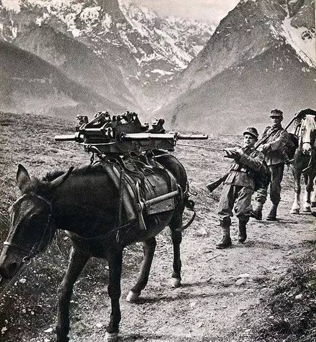
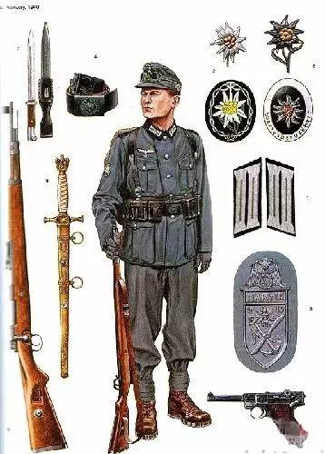
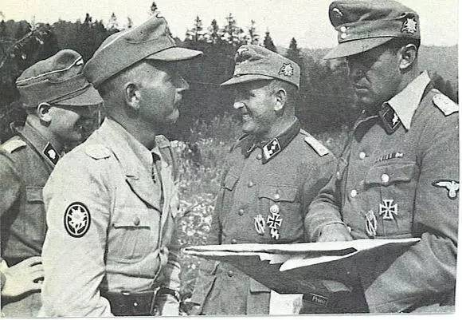

### 雪绒花下的骡马与冰镐：二战德军山地部队面面观

提到二战德军，人们往往先想到装甲师与斯图卡。但在挪威峡湾、克里特岛岩岭、高加索雪峰和意大利修道院废墟里真正唱主角的，是帽子上别着雪绒花（Edelweiß）、靠骡马和冰镐走路的**山地猎兵（Gebirgsjäger）**。他们并非“更硬的步兵”，而是一支为**“没有路的地方”**专门设计的轻型部队：编制缩水、火力轻量化、后勤几乎全靠畜力，战术核心则是“用攀登换时间、用高地换火力”。

---

#### 一、编制骨架：小而精的“两团制”师

- **起源**：1938年由巴伐利亚山地旅组建第1山地师；同年德奥合并后吸收奥地利阿尔卑斯部队，成立第2、第3山地师；1940—1941年又扩编第4—7师，战时最多达10余个师级单位。武装党卫军亦有山地师（如第6“北地”师、第7“欧根亲王”师），但性质与训练水准参差不齐。
- **结构特点**：全师约1.3万—1.5万人，比步兵师少一个步兵团，只辖**2个山地猎兵团**（每团约3064人、3营，每营5个连：3个步枪连＋重装连＋机枪连）。另配山地炮兵团、反坦克营、侦察营（自行车/摩托化）、工兵营、通信营及庞大的师属勤务（含兽医、高山病与冻伤医疗分队、搜救犬）。
- **关键逻辑**：人数少不等于火力弱——营级多出一个机枪连，连排大量配发轻机枪与冲锋枪，重武器全部追求“可分解驮载”。山地师的战斗力来自**地形通过性**，而非吨位。

---

#### 二、后勤：骡马化的山地供应链

这是山地部队最容易被低估、也最决定成败的一环。

**1. 畜力是主力，而非点缀**
- 运力约七成依赖骡马：驮马（奥地利哈夫林格等小型马）单匹载重约80公斤，用于弹药、给养、拆解后的机枪与迫击炮；重型挽马（如诺里克马）负责牵引75毫米山炮；骡子耐粗饲、抗惊吓，最能贴近前线。
- 一匹驮畜需平衡两侧重量，火炮必须能分解成数个驮载件（75毫米山炮可拆成6—8件，105毫米山地榴弹炮亦然），由驮队或人力分段搬运。
- 代价极高：百匹骡马每天需数十公斤草料与兽医保障，草料本身又占用运力。一旦补给线被切断，重火力立刻瘫痪。因此编制表明确区分**“山地版”与“平原版”**（如1944年型山地猎兵师KStN 132 A/B版）——平原用挽马拖车，进山前必须重新编组，否则寸步难行。

**2. 人的负重与冬季装备**
- 单兵负重通常控制在25公斤上下，配短靴加绑腿、双面防风衣、登山绳、冰爪、双头冰镐、雪橇与雪鞋；冬季用**雪橇/雪车（载重200—300公斤）**转运伤员与迫击炮。
- 卫生勤务专配冻伤、高山病药品与担架队，这在海拔四五千米战场是实打实的战斗力。

**3. 当骡马不够用时：空运与海运的赌博**
- 山地师是德军最早大规模使用**空运机降**的陆军单位之一（克里特岛第5山地师）。但运输机数量有限，只能运人不能运骡马与重炮，导致“人到了、炮没到”。
- 海运则受制于敌方海军：山地兵乘慢速小船上岛，常被皇家海军拦截歼灭。可以说，山地部队的天然优势在**垂直地形**，一旦被扔进需要制海权或机械化补给的战场，其短板会被成倍放大。

---

#### 三、武器：一切为了“能拆开背上去”

| 类别 | 主要装备 | 特点 |
|---|---|---|
| 单兵 | Kar98k步枪、MP40冲锋枪、P38手枪、StG44（战争末期少量） | 轻装为主，近战火力密度高 |
| 机枪 | MG34/MG42通用机枪（初期仍有MG08） | 山地战术的绝对核心，可拆分携行，连排火力支柱 |
| 迫击炮 | 50毫米轻迫击炮、GrW34 81毫米、sGrW40/42 120毫米 | 曲射、分解驮载，是山地师最实用的“随叫随到”火炮 |
| 山炮 | 7.5cm GebG36、7.5cm GebIG18、10.5cm GebH40，以及缴获/改制型号 | 可分解驮载，射界好但射程、威力逊于同口径野战火炮 |
| 无后坐力炮 | 10.5cm LG40 | 与空降兵共用，极受山地部队欢迎，适合陡坡直瞄 |
| 反坦克 | Pak 36 37mm → Pak 38 50mm → Pak 40 75mm、28/20mm轻型反坦克炮、铁拳/坦克杀手火箭筒 | 全程是短板：早期37毫米炮对T-34基本无效，中期靠数量与火箭筒弥补 |
| 防空 | 20mm Flak30/38、GebFlak38 | 兼对地压制，山谷中打低空目标效果不错 |
| 工兵 | 登山器材、轻型架桥器材、火焰喷射器、炸药 | 破障、爆破、开辟骡道，常当精锐步兵用 |

一个反复出现的现象是：**战争中后期山地师被大量投入平原、城市与森林战**，专用山炮损耗后得不到补充，便直接换装步兵师制式榴弹炮甚至150毫米火箭炮——“山地师”逐渐只剩番号与传统。

---

#### 四、战术：高地、纵队与渗透

1. **“抢占棱线”优于正面强攻**：山地进攻通常先以侦察尖兵（滑雪者或攀岩小组）沿看似不可攀的侧翼渗透，夺取俯瞰敌阵地的制高点，再把机枪与迫击炮拖上去，自上而下压制谷地道路。谁控制山脊线，谁就控制对方的补给。
2. **多路纵队＋钳形合围**：营连级分成数条纵队沿不同沟谷推进，在目标后方山口会合切断退路。优点是难以被封锁，缺点是一旦某一路受阻，全线停滞，且各纵队之间联络困难（因此山地通信营与背负式电台地位极高）。
3. **火力分散、机动集中**：重武器少且移动慢，故强调机枪与迫击炮的前推与频繁转移阵地，打完即撤，避免被对方反炮兵定位。
4. **冬季与滑雪作战**：滑雪猎兵营可进行长距离迂回、夜袭与断后追击，芬兰—拉普兰方向的战斗证明，一支会滑雪的轻步兵能在零下三四十度把对手的交通线切成碎片。
5. **空中补给与滑翔机支援**：在地面补给断绝时（如纳尔维克、卡西诺），空投成为生命线，但精度与运量极不稳定，往往只能维持“不饿死”，不足以支撑进攻。
6. **反游击战的黑暗面**：在巴尔干，山地师（尤其党卫军第7“欧根亲王”师）长期执行清剿、封锁山口与村庄报复行动。这类行动虽有一定战术成效，却伴随大量针对平民的暴行与战争罪，这是讨论该兵种时不应回避的部分。

---

#### 五、经典战例

**① 纳尔维克（1940年4—6月，挪威）**
第3山地师第139团约2000人由10艘驱逐舰运抵北极圈内的不冻港，随后驱逐舰被英国皇家海军全歼，2500余名水兵上岸编成临时陆战队。迪特尔指挥这支混编部队，在雪地与峡湾间与2万余英法波挪联军周旋六周，最终因法国战局恶化、盟军主动撤离而保住港口。此役确立了山地部队的声望（设立“纳尔维克盾章”，授予约8500人），也暴露了其致命弱点：**远离本土、无海空补给时只能靠缴获与空投硬撑**。

**② 克里特岛（1941年5月，“水星行动”）**
第5山地师作为第7空降师的后续力量，以运输机机降投入战斗。师长林格尔上岛后接管西部战斗群指挥，配合残存伞兵逐屋争夺，12天内拿下全岛。代价惨重：德军伤亡约6000—7000人、损失运输机上两百架。此战是山地师首次大规模“从天而降”，也证明**山地兵可以当轻步兵用，但离开山地与骡马，他们的优势只剩训练与士气**。

**③ 高加索与厄尔布鲁士峰（1942年8月—1943年，“ Edelweiss行动”）**
第49山地军辖第1、第4山地师穿越库班河谷，攻克科鲁赫等山口，混合战斗群于8月21日将万字旗插上5642米的厄尔布鲁士峰——德军推进的最远标志之一。战术上他们展现了极强的**分散重火力、依托高地据点、多方向快速突击**能力；战略上却彻底失败：油田已被苏军破坏，补给线越拉越长，斯大林格勒崩溃后侧翼洞开，该师被迫丢弃重装备翻越七座高山突围，数月间损失过万。登顶成了纯粹的宣传活动，希特勒本人亦斥之为“登山旅游”。

**④ 卡西诺山（1944年，意大利）**
第5山地师等部据守修道院所在的陡峭山脊，将盟军的兵力与空中优势大幅抵消，使古斯塔夫防线坚守数月。这是山地防御战的教科书式案例：**把敌人逼到只能仰攻一条路**。但也再次说明，这类胜利只是迟滞，无法改变战局。

**⑤ 北极与拉普兰（1941—1944）**
第2、第3、第6、第7山地师在芬兰—苏联北极方向进攻摩尔曼斯克铁路线，受限于冻土、极夜与补给极限未能达成目标；1944年后又在拉普兰实施有序撤退（获“拉普兰盾章”）。这是对山地部队耐力最严苛的检验，也是对“后勤决定上限”最冷的注脚。

---

#### 六、几点评价

- **长处**：地形通过性、山地条件下的组织与耐力、轻装火力密度、班排级主动性与攀爬/滑雪技能。在真正的山区，一个山地营往往能挡住远多于自己的对手。
- **短处**：反坦克与远程炮火先天不足；骡马后勤脆弱且消耗巨大；缺乏装甲与机动运输，一旦投入平原即沦为普通轻步兵；过度依赖空运与空运能力不足之间的矛盾始终未解。
- **历史定位**：山地猎兵是二战中最接近“特种化常规部队”的存在之一，但他们终究没能逃脱德国战争机器的一般命运——**战术上的精巧，弥补不了战略上的透支**。精英部队的传奇战绩，常常是用极高的伤亡与平民的苦难换来的。
